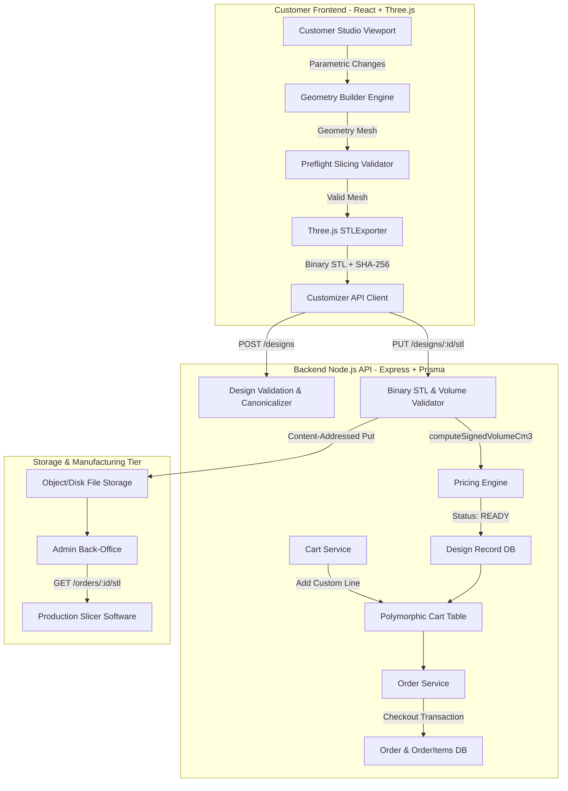
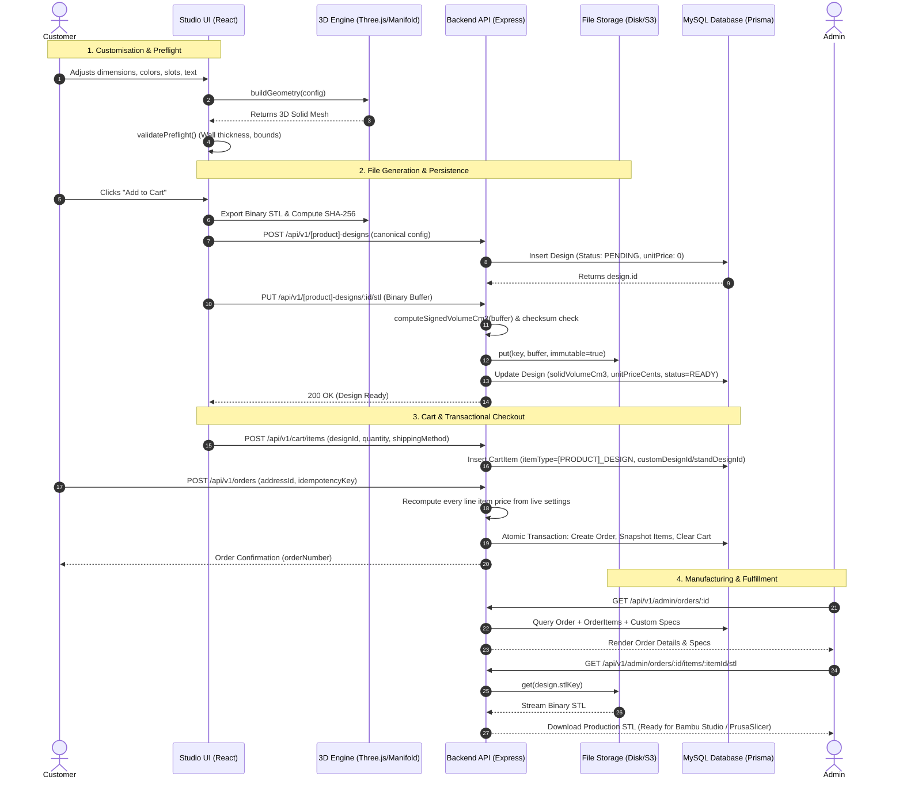
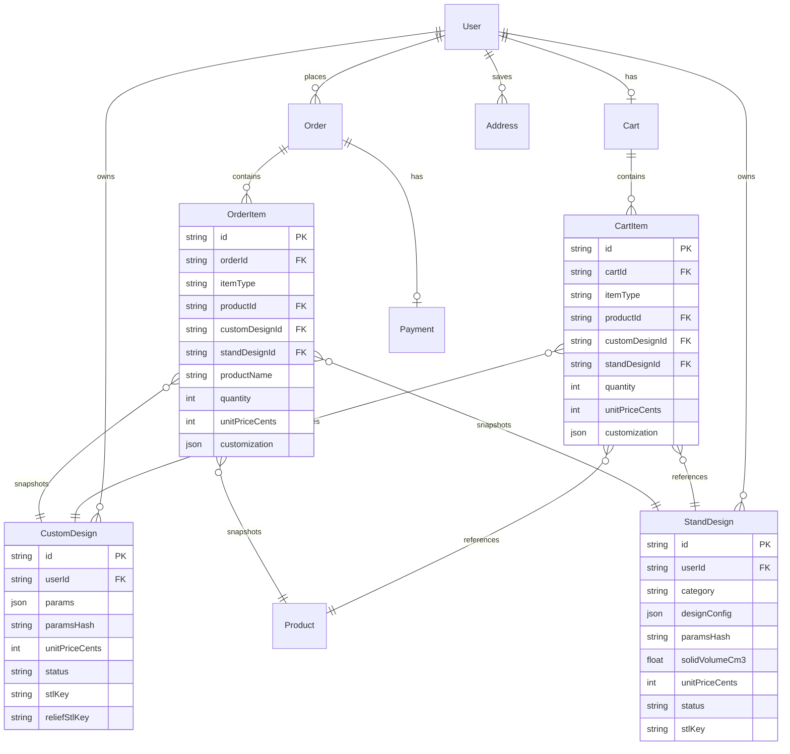

# Future Customiser Development Guide & Architecture Manual

**Platform:** Giftora 3D Customisation E-Commerce Platform  
**Audience:** Full-Stack Engineers & 3D Platform Developers  
**Scope:** Developer Handbook, Sequence Diagrams, ERD, Boilerplates, and Quality Standards  
**Status:** `VERIFIED` & `PRODUCTION_ACTIVE`  

---

## 1. System Architecture Overview

Giftora's 3D customisation platform orchestrates browser-based 3D parametric modeling, server-authoritative geometric verification, and an e-commerce order fulfillment pipeline.



---

## 2. Complete End-to-End Sequence Diagram



---

## 3. Database Entity-Relationship Diagram (ERD)



---

## 4. Standardized Implementation Boilerplates

### 4.1 Canonical Input Validator & Params Hash Generator
```javascript
// src/modules/<product>/<product>Validator.js
import crypto from 'node:crypto'
import { HttpError } from '../../utils/httpError.js'

export function validateInput(rawInput) {
  if (!rawInput || typeof rawInput !== 'object') {
    throw new HttpError(400, 'Invalid configuration payload.')
  }

  // 1. Strict schema canonicalization
  const canonical = {
    category: String(rawInput.category || 'default').trim(),
    dimensions: {
      widthMm: Math.max(10, Math.min(200, Number(rawInput.dimensions?.widthMm) || 50)),
      heightMm: Math.max(10, Math.min(200, Number(rawInput.dimensions?.heightMm) || 50)),
    },
    appearance: {
      finish: String(rawInput.appearance?.finish || 'matte').trim(),
      baseColor: String(rawInput.appearance?.baseColor || '#D9AE4E').trim(),
    }
  }

  // 2. Deterministic Hash Computation (Key-sorted JSON)
  const canonicalJson = JSON.stringify(canonical, Object.keys(canonical).sort())
  const paramsHash = crypto.createHash('sha256').update(canonicalJson).digest('hex')

  return { canonical, paramsHash, title: `${canonical.category.toUpperCase()} Custom Design` }
}
```

### 4.2 Divergence Theorem Volume Engine
```javascript
// src/utils/meshVolumeCalculator.js
export function computeSignedVolumeCm3(buffer) {
  if (!Buffer.isBuffer(buffer) || buffer.length < 84) return 0
  const triangleCount = buffer.readUInt32LE(80)
  if (buffer.length !== 84 + triangleCount * 50) return 0

  let totalVolumeMm3 = 0
  let offset = 84

  for (let i = 0; i < triangleCount; i++) {
    offset += 12 // Skip normal vector
    const x1 = buffer.readFloatLE(offset); const y1 = buffer.readFloatLE(offset + 4); const z1 = buffer.readFloatLE(offset + 8);
    const x2 = buffer.readFloatLE(offset + 12); const y2 = buffer.readFloatLE(offset + 16); const z2 = buffer.readFloatLE(offset + 20);
    const x3 = buffer.readFloatLE(offset + 24); const y3 = buffer.readFloatLE(offset + 28); const z3 = buffer.readFloatLE(offset + 32);
    offset += 38 // Advance to next triangle (36 bytes vertices + 2 bytes attribute)

    // Scalar triple product: v1 . (v2 x v3)
    totalVolumeMm3 += (x1 * (y2 * z3 - z2 * y3) - y1 * (x2 * z3 - z2 * x3) + z1 * (x2 * y3 - y2 * x3)) / 6.0
  }

  return Math.abs(totalVolumeMm3) / 1000.0 // Convert mm³ to cm³
}
```

---

## 5. Development & Code Quality Checklist

Before submitting a Pull Request for a new customisable product:
- [ ] **Design System:** Does the studio adhere strictly to Giftora's Obsidian (`#0D0D0D`) and Gold (`#D9AE4E`) palette?
- [ ] **Sticky Viewport:** Does the 3D canvas remain sticky on the right during desktop scrolling?
- [ ] **Bottom Pricing:** Is the specification and shipping card positioned at the bottom of the left configuration column?
- [ ] **Server Authority:** Is pricing completely recalculated on the server without trusting client prices?
- [ ] **Mesh Validation:** Is the binary STL header validated and volume bounded ($1.0 \le V \le 5000\text{ cm}^3$)?
- [ ] **Zero Duplicate Races:** Is `@@unique([userId, paramsHash])` catching `P2002` concurrent requests safely?
- [ ] **Cart Polymorphism:** Are `CartItem` and `OrderItem` foreign keys mutually exclusive?
- [ ] **Admin Fulfillment:** Can the admin inspect custom specifications and download the production STL from `/orders/:id`?
- [ ] **Build & Unit Tests:** Do `npm test` in backend and `npm run build` in frontends pass cleanly?
