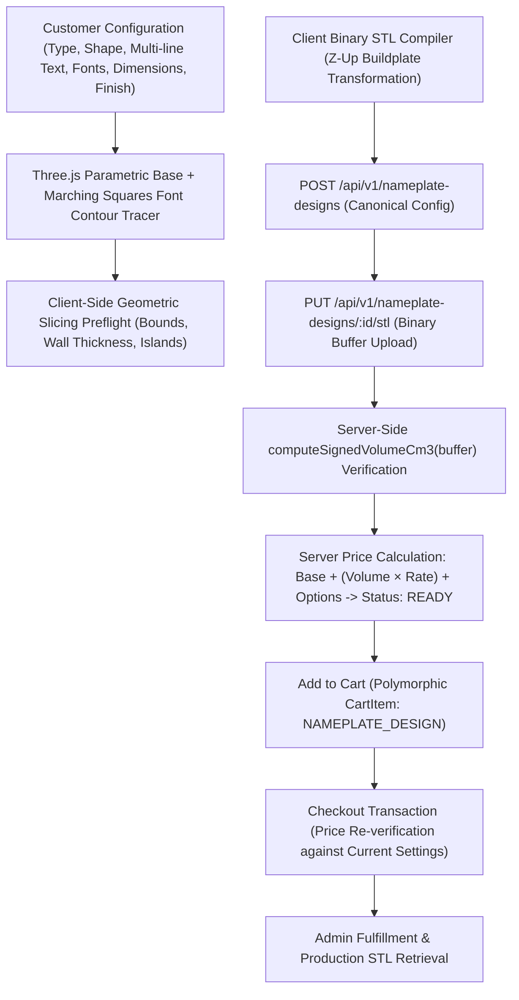

# Product Model 3: Nameplate — Comprehensive Technical Architecture

**Platform:** Giftora 3D Customisation E-Commerce Platform  
**Product Identifier:** `NAMEPLATE`  
**Reference Classification:** Hybrid Volumetric / Multi-Part Model (Product Model 3)  
**Status:** `READY_FOR_INTEGRATION`  

---

## 1. Executive Overview

The **Nameplate** (`/customise/nameplate`) is Giftora's third independent 3D customiser product. It synthesizes the typography strengths of **Product Model 1 (Name Keychain)** with the multi-part parametric assembly and volumetric engineering of **Product Model 2 (Phone & Pen Stand)**.



---

## 2. Product Catalog Taxonomy & Configurations

Nameplate supports 10 distinct architectural and decorative use-cases:

| Type ID | Display Name | Recommended Shape | Recommended Mounting | Default Size (mm) | Base Price (Cents / INR) |
| :--- | :--- | :--- | :--- | :--- | :--- |
| `desk` | Desk Nameplates | `rounded-rectangle` | `freestanding-desk` | $180 \times 50$ | 55,000 / ₹550.00 |
| `door` | Door Nameplates | `arch` | `flat-wall` | $200 \times 70$ | 65,000 / ₹650.00 |
| `wall` | Wall-Mounted Signs | `rectangle` | `flat-wall` | $220 \times 85$ | 75,000 / ₹750.00 |
| `kids` | Kids' Room Nameplates | `cloud` | `layered-background` | $190 \times 85$ | 60,000 / ₹600.00 |
| `business` | Business Signs | `rectangle` | `freestanding-desk` | $210 \times 65$ | 85,000 / ₹850.00 |
| `led` | LED-Style Signs | `hexagon` | `layered-background` | $210 \times 75$ | 95,000 / ₹950.00 |
| `decorative-3d` | Decorative 3D Text | `text-outline` | `text-only-3d` | $185 \times 55$ | 50,000 / ₹500.00 |
| `wedding` | Wedding & Event | `heart` | `freestanding-desk` | $215 \times 80$ | 70,000 / ₹700.00 |
| `house-number` | House Number Plates | `shield` | `flat-wall` | $205 \times 100$ | 65,000 / ₹650.00 |
| `gaming` | Gaming Desk Tags | `hexagon` | `freestanding-desk` | $195 \times 56$ | 60,000 / ₹600.00 |

---

## 3. Frontend Architecture (`apps/customer-frontend`)

### 3.1 Route & Entry Point
- **Route:** `/customise/nameplate`
- **Page Component:** `apps/customer-frontend/src/pages/NameplateCustomiser.jsx`
- **Sub-components:**
  - `StudioLeftPanel.tsx`: 4 tabs (Text & Typography, Shape & Style, Materials & Finishes, Engineering & Mounting).
  - `NameplateCanvas.tsx`: Three.js WebGL viewport canvas with OrbitControls and procedural PMREM lighting.
  - `NameplateMesh.tsx`: Multi-part assembly manager (Base, secondary layer, border, text meshes, emblems, stand).
  - `NameplateCustomizationSummary.jsx`: Live specification card, dynamic volume pricing breakdown, quantity selector, and shipping options.
  - `NameplateFactsCard.jsx`: Production specifications and material durability details.
  - `ViewportControlsBar.tsx`: Camera presets (Isometric, Front, Top, Side, Perspective reset).

### 3.2 Visual & Interaction Alignment with Reference Model
- **Obsidian & Gold Design System:** Deep charcoal surfaces (`#0D0D0D`, `#141414`, `#1A1A1A`), metallic gold accents (`#D9AE4E`, `#F5D77F`), subtle border lines (`#2A2A2A`), and crisp typography.
- **2-Column Layout:** Sticky 3D canvas viewport on the right (desktop); scrollable configuration tabs and bottom specification/shipping card on the left.

### 3.3 3D Geometry Engine
1. **Base Plate Geometry:** Procedural 2D polygon generation (`baseGeometry.ts`) for 20 silhouette shapes, extruded with filleted bevels. Supports engraved letter pockets with counter-islands, through-cutouts with backing diffusers, and raised faceplates.
2. **Text Contour Tracing (`contourTracer.ts` & `textGeometry.ts`):** Renders high-resolution typography on a hidden 2D canvas using the browser's native HarfBuzz layout engine (supporting English and Tamil). Traces alpha pixel contours into vector polygons using Marching Squares and simplifies them via Douglas-Peucker. Extrudes polygons into solid 3D Three.js meshes.
3. **Mounting & Emblems (`mountingGeometry.ts`):** Generates 18 procedural emblems (Stars, Crowns, Mandalas, Laurel Wreaths, etc.), screw mounting holes, keyhole slots, and angled freestanding desk stands with reinforcement ribs.
4. **PBR Materials (`materials.ts`):** Real-time shaders simulating Matte, Silk, Metallic, Wood, Marble, and Translucent PLA with roughness, clearcoat, and emissive LED glow channels.

---

## 4. Server-Authoritative Volumetric Pricing Engine

### 4.1 Pricing Formula
$$\text{UnitPriceCents} = \text{BaseTypePriceCents} + \left( \lceil \text{SolidVolumeCm3} \rceil \times \text{PricePerCm3Cents} \right) + \text{FeatureSurchargesCents}$$

- **Feature Surcharges:**
  - LED Glow / Diffuser Rim: +₹150.00 (15,000 cents)
  - Layered Background Backplate: +₹100.00 (10,000 cents)
- **Server Authority:** Just as in Product Model 2, the client's volume estimate is purely for UI guidance. When the client uploads the binary STL, `computeSignedVolumeCm3(buffer)` calculates the exact solid volume on the server using the divergence theorem. The server locks the unit price based on this measurement and active admin settings.

---

## 5. Database Persistence & Schema

### 5.1 `nameplate_designs` Table (`prisma/schema.prisma`)
```prisma
model NameplateDesign {
  id               String       @id @default(cuid())
  userId           String
  user             User         @relation(fields: [userId], references: [id], onDelete: Restrict)
  schemaVersion    Int          @default(1)
  title            String
  nameplateType    String       @db.VarChar(40)
  shape            String       @db.VarChar(40)
  mountingStyle    String       @db.VarChar(40)
  designConfig     Json
  paramsHash       String
  unitPriceCents   Int
  solidVolumeCm3   Float?
  status           DesignStatus @default(PENDING)
  stlKey           String?      @unique
  stlSha256        String?
  stlSizeBytes     Int?
  triangleCount    Int?
  bboxMm           Json?
  previewKey       String?
  previewSizeBytes Int?
  createdAt        DateTime     @default(now())
  updatedAt        DateTime     @updatedAt

  cartItems        CartItem[]
  orderItems       OrderItem[]

  @@unique([userId, paramsHash])
  @@index([userId])
  @@index([status])
  @@map("nameplate_designs")
}
```

---

## 6. Cart, Checkout & Admin Management

### 6.1 Polymorphic E-Commerce Substrate
- Stored in `cart_items` and `order_items`:
  - `itemType`: `'NAMEPLATE_DESIGN'`
  - `nameplateDesignId`: Foreign key to `nameplate_designs.id`
  - `customDesignId`: `NULL`
  - `standDesignId`: `NULL`
  - `productId`: `NULL`
- **Checkout Guard:** During order placement in `orderService.js`, the server verifies STL file availability and re-computes `priceForNameplate(design.nameplateType, design.solidVolumeCm3, design.designConfig, nameplatePricingConfig)`.

### 6.2 Admin Control Center (`apps/admin-frontend`)
- **Settings Panel:** `/customization/nameplate` (`NameplateCustomizationSettings.jsx`) controlling:
  - Base prices for all 10 Nameplate types.
  - Per-cm³ volumetric material rate.
  - Surcharges for LED Glow and Layered backing.
  - Integrated `ShippingManager` for delivery rates.
- **Order Inspector (`OrderDetail.jsx`):** Renders Nameplate specifications (Type, Shape, Mounting, Dimensions, Finishes, Colors, Volume) and provides direct production binary STL downloads.
