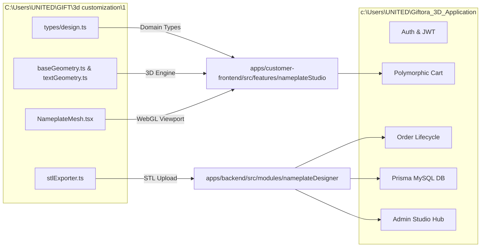

# Nameplate Source Project Analysis Report

**Source Location:** `C:\Users\UNITED\GIFT\3d customization\1`  
**Target Application:** Giftora / JAS 3D Makers (`c:\Users\UNITED\Giftora_3D_Application`)  
**Product Identifier:** `NAMEPLATE` (Product Model 3)  
**Status:** `ANALYSIS_COMPLETE`  

---

## 1. Executive Summary

An exhaustive inspection of the supplied source project at `C:\Users\UNITED\GIFT\3d customization\1` reveals a modern, browser-based 3D Nameplate Customizer written in React 19, TypeScript, Vite, and Three.js (`@react-three/fiber` / `@react-three/drei`).

The source project is a pure client-side Single Page Application (SPA) containing no dedicated backend, database, or cart infrastructure. Instead, it generates 3D geometries and binary STLs entirely on the client, and uses local state for design manipulation.

To integrate Nameplate into Giftora:
1. **Extract ONLY** the core 3D mathematical geometry generation, font contour tracing, PBR materials, mounting systems, and preset configurations.
2. **Exclude** the standalone demo pages, mock local storage saving, and unrelated UI wrappers.
3. **Bridge** the extracted 3D engine into Giftora's established **Obsidian & Gold luxury design system**, **two-column customizer layout**, **polymorphic cart**, **Prisma MySQL database**, and **admin fulfillment center**.

---

## 2. Source Project Breakdown (18 Analysis Dimensions)

| Dimension | Findings & Implementation Details |
| :--- | :--- |
| **1. Frontend Framework** | React 19.0.1, TypeScript 7.0.2, Vite 8.3.0, Tailwind CSS 4.3.3. Fully compatible with Giftora's React 19 / Vite stack. |
| **2. Main Customiser Page** | `src/components/DesignStudio.tsx` (2,073 lines) managing 4 tabs: Text, Shape, Material, and Engineering. |
| **3. Components & UI** | `Viewport3D.tsx`, `NameplateMesh.tsx`, `TemplatesPage.tsx`, `MyDesignsPage.tsx`, `PrintSettingsPage.tsx`, `HelpPage.tsx`. |
| **4. 3D Rendering Engine** | Three.js (`three` 0.187.0) with `@react-three/fiber` (9.0.0) and `@react-three/drei` (10.0.0). Uses procedural `RoomEnvironment` PMREM for realistic studio reflections with zero HDR file downloads. |
| **5. Geometry Generation** | Multi-part parametric extrusions (`baseGeometry.ts`, `mountingGeometry.ts`) yielding base plate, secondary backing plate, raised border frame, decorative emblems, and freestanding desk stands. |
| **6. Text & Font Handling** | High-precision Canvas2D HarfBuzz font shaping + Marching Squares alpha contour tracing (`contourTracer.ts`, `textGeometry.ts`) converting any Google Web Font into true 2D vector polygons with inner counter-island holes in millimeters. |
| **7. Shapes & Templates** | 20 mathematical silhouette shapes (Rectangle, Rounded Rect, Oval, Circle, Hexagon, Octagon, Diamond, Shield, Crest, Cloud, Heart, Arch, Scalloped, Ribbon Banner, Ticket Notch, Chamfer Plate, House Roof, Butterfly, Starburst, Text Outline). |
| **8. Materials & Finishes** | 7 realistic PBR filament finishes (`matte-pla`, `silk-pla`, `metallic-pla`, `wood-pla`, `marble-pla`, `transparent`, `dual-color`) with tuned roughness, metalness, and clearcoat values. |
| **9. Dimensions & Sizes** | Fully parameterized dimensions: Width ($100–300\text{ mm}$), Height ($40–150\text{ mm}$), Base Thickness ($2–8\text{ mm}$), Corner Radius ($0–25\text{ mm}$), Text Extrusion ($0.6–4.0\text{ mm}$), and Engraving Depth ($0.4–3.0\text{ mm}$). |
| **10. Personalisation** | Up to 4 customizable text lines with font selection, font size, letter spacing, alignment, bold, italic, case transforms (`UPPER`, `lower`, `Title`), text colors, 18 3D decorative emblems (Stars, Crown, Laurel, Mandala, etc.), and optional LED edge glow rim. |
| **11. Pricing Calculation** | Physical mass and print-time estimator (`pricingEstimator.ts`) calculating volume, filament weight, print hours, machine rate, and markup. |
| **12. Preview Generation** | WebGL canvas capture via `gl.domElement.toDataURL('image/png')`. |
| **13. STL / 3D Export** | Client-side binary STL generator (`stlExporter.ts`) shifting parts to printer build plate ($Z \ge 0$), mapping $Y\text{-up} \to Z\text{-up}$, and 3MF container exporter (`threemfExporter.ts`). |
| **14. Backend APIs** | **None present in source project.** Must be created in Giftora following the established Product Model 2 API patterns. |
| **15. Database Models** | **None present in source project.** Must be created in Giftora via Prisma (`NameplateDesign` table). |
| **16. External Libraries** | `three`, `@react-three/fiber`, `@react-three/drei`, `lucide-react`, `motion`, `jszip`. **All already installed in Giftora!** |
| **17. Assets & Fonts** | Google Web Fonts loaded dynamically via Google Fonts CSS API; zero local heavy binary font files required. |
| **18. Customer Workflow** | Standalone editor without checkout. Must be adapted to Giftora's reference workflow: Shape $\to$ Text $\to$ Material $\to$ Dimensions $\to$ 3D Review $\to$ Shipping Selection $\to$ Add to Cart $\to$ Checkout. |

---

## 3. Source File Selection & Dependency Map

### 3.1 Files Selected for Extraction & Adaptation
These files contain the pure domain logic and 3D math required for Nameplate:
1. `src/types/design.ts` $\longrightarrow$ Adapted into Giftora `core/types.ts`.
2. `src/data/fonts.ts` $\longrightarrow$ Adapted into Giftora `core/fonts.ts` (70+ fonts).
3. `src/data/presets.ts` $\longrightarrow$ Adapted into Giftora `core/presets.ts` (10 plate types, 20 shapes, 18 decorations, 7 finishes).
4. `src/utils/contourTracer.ts` $\longrightarrow$ Adapted into Giftora `geometry/contourTracer.ts` (Marching Squares).
5. `src/utils/baseGeometry.ts` $\longrightarrow$ Adapted into Giftora `geometry/baseGeometry.ts` (20 parametric shapes).
6. `src/utils/textGeometry.ts` $\longrightarrow$ Adapted into Giftora `geometry/textGeometry.ts` (Multi-line vector text).
7. `src/utils/mountingGeometry.ts` $\longrightarrow$ Adapted into Giftora `geometry/mountingGeometry.ts` (Emblems, stands, holes).
8. `src/utils/materials.ts` $\longrightarrow$ Adapted into Giftora `geometry/materials.ts` (PBR shaders).
9. `src/utils/geometryValidation.ts` $\longrightarrow$ Adapted into Giftora `geometry/validation.ts` (Print bed bounds & wall checks).
10. `src/utils/stlExporter.ts` $\longrightarrow$ Adapted into Giftora `geometry/stlExporter.ts` (Binary STL compiler).
11. `src/components/NameplateMesh.tsx` $\longrightarrow$ Adapted into Giftora `components/NameplateMesh.tsx`.
12. `src/components/Viewport3D.tsx` $\longrightarrow$ Adapted into Giftora `components/NameplateCanvas.tsx`.

### 3.2 Files Intentionally Excluded
These files belong to the demo scaffolding or duplicate Giftora's platform layer:
- `src/App.tsx`, `src/main.tsx`, `index.html`: Standalone shell and index.
- `src/components/Header.tsx`, `src/components/HomePage.tsx`: Generic header and landing page.
- `src/components/HelpPage.tsx`, `src/components/MyDesignsPage.tsx`, `src/components/PrintSettingsPage.tsx`: Standalone mock pages.
- `src/components/TemplatesPage.tsx`: Mock catalog (templates are integrated directly into Giftora's customizer left panel).
- `src/utils/designReducer.ts`: Local undo/redo reducer (Giftora uses React state with reset capability).
- `src/utils/svgExporter.ts`: 2D laser export (Giftora is focused on 3D printing).
- `bun.lock`, `package.json`, `tsconfig.json`: Project build configurations.
- `.aistudio/`: AI Studio metadata and conversation cache.

---

## 4. Architectural Integration Assessment

The extraction is clean and zero-regression: no existing code in Name Keychain or Phone & Pen Stand will be touched or degraded.
