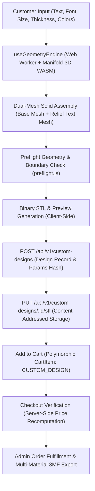

# Product Model 1: Name Keychain — Comprehensive Technical Architecture

**Platform:** Giftora 3D Customisation E-Commerce Platform  
**Product Identifier:** `NAME_KEYCHAIN`  
**Reference Classification:** Reference Implementation (Product Model 1)  
**Status:** `VERIFIED` & `PRODUCTION_ACTIVE`  

---

## 1. Executive Overview

The **Name Keychain** (`/customise`) serves as the foundational reference model for 3D parametric customisation in the Giftora ecosystem. It demonstrates a text-driven CSG (Constructive Solid Geometry) workflow where customer typographic input is transformed in real-time into a dual-color, multi-part 3D solid mesh directly inside the customer's browser using WebAssembly.



---

## 2. Frontend Architecture (`apps/customer-frontend`)

### 2.1 Route & Entry Point
- **Route:** `/customise`
- **Page Component:** `apps/customer-frontend/src/pages/Customiser.jsx`
- **Hub Navigation:** Accessible from `/customise/hub` via `ProductHubCard.jsx`
- **Theme & Layout:** Giftora Luxury Obsidian (`#0D0D0D`, `#1A1A1A`) and Metallic Gold (`#D9AE4E`) 2-column layout.
  - **Desktop (>= 1024px):** Left column contains scrollable configuration panels; right column contains sticky 3D WebGL viewport and bottom specification/pricing summary card.
  - **Mobile (< 1024px):** Single-column stacked layout with viewport on top and collapsible configuration drawers.

### 2.2 Customisation Workflow & Tabs
The customisation process follows 5 progressive stages:
1. **Text & Typography:** Primary text input (1–12 characters), optional subtitle (1–16 characters), font selection (8 curated Google Fonts rendered as 3D glyph paths).
2. **Template & Shape:** Silhouette templates (Classic Rectangular, Rounded Capsule, Wave, Cloud, Hexagon, Badge).
3. **Dimensions & Profile:** Length/width scaling (`Standard: 65mm`, `Compact: 50mm`, `Large: 80mm`), base thickness (`3.0mm`, `4.0mm`, `5.0mm`), keyring hole positioning (`Left`, `Right`, `Top-Left`).
4. **Colors & Material:** Dual-color selection (Base body color + Text relief color) mapped to verified PLA filament inventory.
5. **Specification & Shipping:** Live character calculation breakdown, manufacturing facts, and interactive shipping carrier selection.

### 2.3 Input Validation & Preflight Checks (`preflight.js`)
Before geometry compilation and cart submission, `apps/customer-frontend/src/features/customiser/validation/preflight.js` enforces strict printability constraints:
- **Character Envelope:** Enforces minimum 1 character, maximum 12 uppercase characters for primary line.
- **Letter Interconnection:** Ensures adjacent extruded glyphs intersect or anchor to the backplate with $\ge 1.2\text{ mm}$ overlap to prevent floating islands.
- **Keyring Eyelet Integrity:** Wall thickness around the keyring hole must maintain $\ge 2.0\text{ mm}$ solid perimeter to resist mechanical shear.
- **Aspect Ratio & Slicing Bed Bounds:** Bounding box restricted to $100\text{ mm} \times 40\text{ mm} \times 15\text{ mm}$, well within the $220 \times 220 \times 250\text{ mm}$ build volume.

### 2.4 3D Geometry Engine (`useGeometryEngine.js`)
- **Core Technology:** `manifold-3d` compiled to WebAssembly (WASM), executed inside a dedicated Web Worker (`geometry.worker.js`) to prevent main-thread UI stuttering.
- **Font Kerning & Glyph Extrusion:** OpenType.js parses font TTF files, extracts vector Bézier curves, and triangulates 2D contours into 3D prismatic solids.
- **CSG Operations:**
  - Base plate creation via 2D profile extrusion with corner filleting.
  - Text relief unioned with base plate or subtracted for debossed engravings.
  - Keyring eyelet boolean subtracted through the solid base plate.
- **Mesh Outputs:** Yields two distinct meshes:
  1. `baseMesh`: Prismatic backplate with eyelet.
  2. `textMesh`: Raised or recessed typographic relief.

---

## 3. Backend Architecture (`apps/backend`)

### 3.1 API Endpoints
All customiser endpoints are encapsulated in `apps/backend/src/modules/customizer/customizerRoutes.js`:
- `GET /api/v1/customizer/options`: Returns available fonts, templates, sizes, thicknesses, and color palettes.
- `POST /api/v1/custom-designs`: Validates canonical customer options and creates a design record (Status: `PENDING`).
- `PUT /api/v1/custom-designs/:id/stl`: Validates binary STL buffer, computes SHA-256 checksum, stores to storage driver, and transitions status to `READY`.
- `PUT /api/v1/custom-designs/:id/preview`: Stores generated WebP/PNG preview image.
- `GET /api/v1/custom-designs/:id`: Retrieves public design metadata.

### 3.2 Pricing Engine Algorithm (`pricingCalculator.js`)
Pricing for Name Keychain is character-count driven with additive tier surcharges:

$$\text{UnitPriceCents} = \text{BasePrice} + \max(0, \text{CharCount} - \text{BaseChars}) \times \text{PerCharRate} + \text{SizeSurcharge} + \text{ThicknessSurcharge}$$

- **Server Authoritative:** The backend recalculates this formula in `priceForDesign()` during design creation, cart addition, and checkout. Any client-sent price is strictly ignored.
- **Admin Configurable:** Stored in the `settings` table under key `customizer_pricing`:
  ```json
  {
    "basePriceCents": 19900,
    "baseCharacters": 4,
    "perCharacterPriceCents": 2500
  }
  ```

### 3.3 Design Persistence & Deduplication
- **Table:** `custom_designs` in MySQL (`schema.prisma`).
- **Canonical Hash (`paramsHash`):** A SHA-256 hash of the normalized JSON string containing `{ text, font, template, size, thickness, baseColor, textColor }`.
- **Deduplication:** A compound unique index `@@unique([userId, paramsHash])` ensures that identical designs by the same user reuse the existing record, avoiding database bloat.

---

## 4. Multi-Material Manufacturing & File Pipeline

### 4.1 STL Validation (`stlValidator.js`)
When the client uploads the generated binary STL:
1. Validates 80-byte binary STL header.
2. Reads 4-byte triangle count ($N$) and verifies byte length: $\text{ExpectedBytes} = 84 + (N \times 50)$.
3. Computes SHA-256 hash and verifies against client claimed checksum.
4. Computes bounding box dimensions ($\le 120\text{ mm} \times 60\text{ mm} \times 20\text{ mm}$).

### 4.2 3MF Color Container Export (`threeMfExporter.js`)
To support Bambu Lab and Prusa multi-color 3D printers:
- Assembles an Open Packaging Convention (OPC) ZIP archive with `.3mf` extension.
- Embeds dual-mesh objects: Object 1 (Base Color filament ID) and Object 2 (Text Color filament ID).
- Injects `3D/3dmodel.model` XML metadata containing precise filament assignment and RGB color swatches.

---

## 5. Cart, Checkout & Orders Integration

### 5.1 Polymorphic Cart Item
- Stored in `cart_items` table:
  - `itemType`: `'CUSTOM_DESIGN'`
  - `customDesignId`: Foreign key to `custom_designs.id`
  - `productId`: `NULL`
  - `standDesignId`: `NULL`
  - `unitPriceCents`: Server-verified unit price.

### 5.2 Transactional Order Placement (`orderService.js`)
During `POST /api/v1/orders`:
1. Verifies that `customDesign.status === 'READY'` and STL file exists on disk/S3.
2. Re-reads admin pricing configuration and recomputes exact unit price. If price changed since cart addition, rejects with `409 Conflict`.
3. Creates `order_items` record linking `customDesignId` and copies a permanent snapshot of title, colors, and configuration.

---

## 6. Admin Control Center (`apps/admin-frontend`)

### 6.1 Customizer Settings (`CustomizationSettings.jsx`)
- Route: `/customization/name-keychain`
- **Section 1: Base Character Pricing:** Base characters, base price (₹), and per-character rate (₹).
- **Section 2: Colors & Materials:** Dynamic color palette manager (Add/remove filament colors, hex codes, stock status).
- **Section 3: Size & Thickness Options:** Surcharges for Compact/Standard/Large and 3mm/4mm/5mm profiles.
- **Section 4: Shipping Methods:** Standard and Quick delivery rate manager.

### 6.2 Order Fulfillment & Downloads (`OrderDetail.jsx`)
- Route: `/orders/:id`
- Inspects customer text, font, base color swatch, and text color swatch.
- Download buttons:
  - `Download STL`: Fetches binary single-body or base STL.
  - `Download 3MF`: Fetches multi-color production-ready 3MF file for Bambu Studio / PrusaSlicer.
