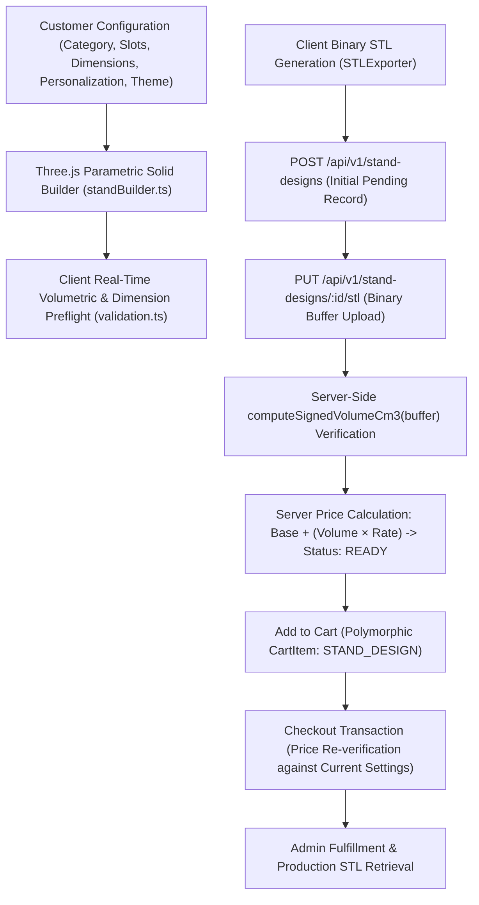

# Product Model 2: Phone & Pen Stand — Comprehensive Technical Architecture

**Platform:** Giftora 3D Customisation E-Commerce Platform  
**Product Identifier:** `PHONE_PEN_STAND`  
**Reference Classification:** Volumetric / Multi-Part Model (Product Model 2)  
**Status:** `VERIFIED` & `PRODUCTION_ACTIVE`  

---

## 1. Executive Overview

The **Phone & Pen Stand** (`/customise/stand`) represents Giftora's volumetric and multi-part product category. Unlike the text-centric character-count model of the Name Keychain, the Phone & Pen Stand utilizes a parametric 3D assembly engine built on Three.js and employs **server-authoritative solid volume pricing** derived directly from the physical plastic volume ($\text{cm}^3$) of the 3D-printed mesh.



---

## 2. Product Catalog Taxonomy & Categories

The studio supports 5 distinct parametric functional archetypes:

| Category ID | Display Name | Base Price (Cents / INR) | Functional Elements |
| :--- | :--- | :--- | :--- |
| `phone-stand` | Phone Stand | 50,000 / ₹500.00 | Angled cradle, cable pass-through, front retention lip, rear support strut |
| `pen-holder` | Pen Holder | 60,000 / ₹600.00 | Cylindrical/hexagonal pen cavities (1–6 slots), weighted solid base |
| `combined` | Combined Phone + Pen Stand | 90,000 / ₹900.00 | Integrated dual-tier chassis with phone cradle and multi-pen organizer block |
| `desk-organizer` | Desk Organizer | 120,000 / ₹1,200.00 | Multi-compartment tray, phone cradle, stylus slots, paperclip basin |
| `personalized-gift`| Personalized Gift Stand | 80,000 / ₹800.00 | Prominent typographic plaque, decorative filleted borders, motif badges |

---

## 3. Frontend Architecture (`apps/customer-frontend`)

### 3.1 Route & Entry Point
- **Route:** `/customise/stand`
- **Page Component:** `apps/customer-frontend/src/pages/StandCustomiser.jsx`
- **Sub-components:**
  - `StudioLeftPanel.tsx`: Accordion/tab-based configuration panel for category, geometry, appearance, and personalization.
  - `StandCustomizationSummary.jsx`: Live specification card, dynamic volume pricing breakdown, quantity selector, and shipping options.
  - `StandFactsCard.jsx`: Production specifications and material durability details.
  - `ViewportControlsBar.tsx`: Camera presets (Isometric, Front, Top, Side, Perspective reset, Wireframe toggle).
  - `StandCanvas.tsx`: Three.js WebGL viewport canvas with OrbitControls.

### 3.2 Visual & Interaction Alignment with Reference Model
In accordance with Giftora's luxury gold and obsidian design system:
- **Colors:** Deep Charcoal/Obsidian background (`#0D0D0D`, `#141414`), Card surfaces (`#1A1A1A`), Metallic Gold accents (`#D9AE4E`, `#F5D77F`), and muted borders (`#2A2A2A`).
- **Layout:** Replicates Name Keychain's 2-column desktop layout. The 3D viewport remains sticky while the user configures parameters on the left. The summary, shipping, and checkout CTA are anchored at the bottom of the left column.

### 3.3 Parametric Geometry Engine (`standBuilder.ts`)
Geometry generation does not rely on WASM CSG, but rather direct parametric solid generation using Three.js buffer geometry:
1. **Base Plate:** Beveled rectangular prism with rounded fillets generated using `ExtrudeGeometry` with smooth Bezier splines.
2. **Phone Cradle:** Angled backrest ($60^\circ$ to $80^\circ$ incline) with a 12–18 mm phone retention lip and central $16\text{ mm}$ USB-C cable relief slot.
3. **Pen Wells:** Array of cylindrical cavities booleanned into solid riser blocks with tapered entry chamfers.
4. **Personalization Plaque:** Raised text extruded using `FontLoader` and `TextGeometry`, affixed to the front chamfer or backrest plate.
5. **Motif Badges:** Procedural 3D relief geometries (Star, Heart, Flower, Leaf, Gear, Hexagon, Diamond).

---

## 4. Server-Authoritative Volumetric Pricing Engine

### 4.1 Divergence from Character Model
Unlike Name Keychain, customer text length does **not** determine the base price. Pricing is strictly governed by the solid plastic displacement:

$$\text{UnitPriceCents} = \text{CategoryBasePriceCents} + \left( \lceil \text{SolidVolumeCm3} \rceil \times \text{PricePerCm3Cents} \right)$$

### 4.2 Server-Side Signed Volume Computation (`stlValidator.js`)
To prevent client-side price tampering (e.g. sending artificially reduced volume figures):
1. The client calculates an estimated volume for UI guidance only.
2. In `POST /api/v1/stand-designs`, the design is created with `unitPriceCents: 0` and `status: PENDING`.
3. In `PUT /api/v1/stand-designs/:id/stl`, the server receives the raw binary STL buffer.
4. The server executes `computeSignedVolumeCm3(buffer)` using the divergence theorem on all triangles:

$$V = \frac{1}{6} \sum_{i=1}^{N} \mathbf{v}_{1,i} \cdot (\mathbf{v}_{2,i} \times \mathbf{v}_{3,i})$$

5. The server enforces safety boundaries ($1.0\text{ cm}^3 \le V \le 5000.0\text{ cm}^3$).
6. The server loads active pricing settings via `getStandPricingConfig()` and updates the database row with the authoritative `solidVolumeCm3`, `unitPriceCents`, and sets `status = 'READY'`.

---

## 5. Database Persistence & Schema

### 5.1 `stand_designs` Table (`prisma/schema.prisma`)
The stand customizer utilizes a dedicated model reflecting multi-part configurations:

```prisma
model StandDesign {
  id               String       @id @default(cuid())
  userId           String
  user             User         @relation(fields: [userId], references: [id], onDelete: Restrict)
  schemaVersion    Int          @default(1)
  title            String
  category         String       @db.VarChar(40)
  designConfig     Json
  paramsHash       String
  unitPriceCents   Int
  solidVolumeCm3   Float?
  status           DesignStatus @default(PENDING)
  stlKey           String?      @unique
  stlSha256        String?
  stlSizeBytes     Int?
  triangleCount    Int?
  bboxMm           Json?
  previewKey       String?
  previewSizeBytes Int?
  createdAt        DateTime     @default(now())
  updatedAt        DateTime     @updatedAt

  cartItems        CartItem[]
  orderItems       OrderItem[]

  @@unique([userId, paramsHash])
  @@index([userId])
  @@index([status])
  @@map("stand_designs")
}
```

### 5.2 `designConfig` Canonical JSON Payload
```json
{
  "category": "combined",
  "phone": {
    "tiltAngleDeg": 70,
    "slotWidthMm": 85,
    "phoneThickness": 14,
    "cablePassThrough": true
  },
  "pen": {
    "slotCount": 3,
    "arrangement": "row",
    "holeDiameterMm": 12,
    "holeDepthMm": 45
  },
  "personalization": {
    "text": "SURENDAR",
    "font": "modern-sans",
    "motif": "star",
    "mode": "embossed"
  },
  "appearance": {
    "finish": "metallic-gold",
    "themeId": "luxury-executive",
    "colors": {
      "base": "#D9AE4E",
      "text": "#0D0D0D"
    }
  }
}
```

---

## 6. Cart, Checkout & Admin Management

### 6.1 Polymorphic Cart & Order Items
- `CartItem` and `OrderItem` use:
  - `itemType: 'STAND_DESIGN'`
  - `standDesignId: <StandDesign.id>`
  - `customDesignId: NULL`
  - `productId: NULL`
- **Checkout Guard:** In `orderService.js`, the server recomputes `priceForStand(item.standDesign.category, item.standDesign.solidVolumeCm3, standPricingConfig)` against live admin pricing. If the admin updated rates while the item was in cart, the checkout refuses with a descriptive error requiring cart refresh.

### 6.2 Admin Studio Settings (`StandCustomizationSettings.jsx`)
- Route: `/customization/phone-pen-stand`
- **Section 1: Volumetric Pricing Engine:** Base prices for all 5 categories + Per-cm³ material rate (₹).
- **Section 2: Shipping & Delivery Rates:** Directly configures Standard Delivery and Quick Courier fees which reflect immediately in customer studio and order checkouts.

### 6.3 Admin Order Fulfillment (`OrderDetail.jsx`)
- Displays category, slots, cradle width, measured solid volume ($\text{cm}^3$), base color, and text color.
- Provides direct download of the production binary STL generated during customer session.
