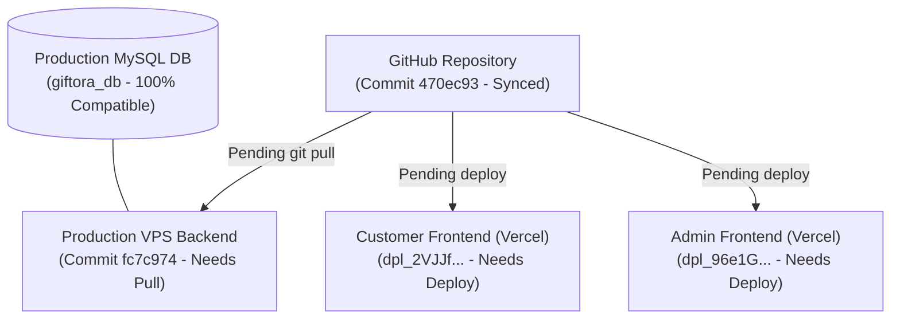

# Giftora — Production Server, Database Migration & Vercel Deployment Audit

**Audit Date:** 2026-11-19  
**Role:** Senior DevOps Engineer + Full-Stack Production Auditor  
**Workspace:** `C:\Users\UNITED\Giftora_3D_Application`  
**Latest GitHub Commit:** `470ec9334ce676fde3a2dbe1e156888e14362f7d` (`470ec93`)  
**Target Branch:** `main`  
**Audit Mode:** **STRICT READ-ONLY AUDIT (Zero Mutations Executed)**

---

## Executive Summary & Key Answers

| Question | Answer | Evidence |
| :--- | :--- | :--- |
| **1. Is latest backend code deployed on production VPS?** | **NO** | VPS is running commit `fc7c974`. Commit `470ec93` has been pushed to GitHub but not pulled to VPS. |
| **2. Has any migration been applied on production server?** | **NO (Not for 470ec93)** | Stand migration `20261116180000_add_stand_designs` was successfully applied on 2026-11-18. No new migration exists or was run for 470ec93. |
| **3. Is DB schema compatible with current Prisma schema?** | **YES** | Commit `470ec93` introduced **0 schema changes** (`git diff fc7c974..470ec93 -- schema.prisma` is empty). Live DB is 100% compatible. |
| **4. Has Vercel deployed commit `470ec93` to Customer?** | **NO** | Vercel deployment `dpl_2VJJf6DaaESGmEAF4uUr5kn7kUnW` was created at 15:41:09 GMT+0530, prior to `470ec93` (17:21:45). Live bundle `index-BJsub3SZ.js` lacks `NAMEPLATE_DESIGN`. |
| **5. Has Vercel deployed commit `470ec93` to Admin?** | **NO** | Vercel deployment `dpl_96e1GdBDNY41S1kKKoxe8Hf5foQ1` was created at 15:42:10 GMT+0530. Live bundle `index-C-MtMYzj.js` lacks `NameplateCustomizationSettings`. |
| **6. What actions are required to make it fully operational?** | **3 Actions** | 1. `git pull && pm2 reload` on VPS. 2. Deploy Customer to Vercel. 3. Deploy Admin to Vercel. **No DB migration required.** |

---

## Phase 1 — Verify VPS Backend Deployment

### VPS Connection & Identity
- **Host / Port:** `37.187.159.43:20065`
- **Application Directory:** `/var/www/Giftora_3D_Application`
- **PM2 Process Name:** `giftora-backend` (ID `0`, Mode `fork`, Status `online`)
- **Port:** `4000` (proxied by Nginx / Caddy at `https://api.jasvel3dmakers.co.in`)
- **Current Deployed Commit on VPS:** `fc7c974be617cd6d35fb032b72e833372e1aa887` (`fc7c974`)
  - Pulled at: `Thu Nov 19 15:25:26 2026 +0530`
  - GitHub Latest: `470ec9334ce676fde3a2dbe1e156888e14362f7d` (`470ec93` at `17:21:45 +0530`)

### Backend Live Endpoint Status
- **`GET /api/v1/health`**:
  ```http
  HTTP/1.1 200 OK
  {"status":"ok"}
  ```
- **`GET /api/v1/nameplate-designer/options`**:
  ```http
  HTTP/1.1 200 OK
  {"options":{"schemaVersion":1,"types":[...10 types...],"pricePerCm3Cents":120}}
  ```
- **`GET /api/v1/settings/nameplate-pricing`**:
  ```http
  HTTP/1.1 200 OK
  {"nameplatePricing":{"pricePerCm3Cents":120,"ledGlowSurchargeCents":15000,...}}
  ```
- **`GET /api/v1/nameplate-designs/test-id/preview`**:
  - Responds with `401 Unauthorized` (`{"error":"Authentication required."}`) due to router-level auth middleware.
  - In commit `fc7c974`, the route handler `GET /:id/preview` does not exist; only `PUT /:id/preview` was mounted.
- **`apps/backend/src/modules/checkout/checkoutService.js` Status:**
  - On VPS, `checkoutService.js` is at commit `fc7c974`. It lacks the `if (isNameplate)` review branch added in commit `470ec93`.

**Verdict:** **NO — The Nameplate checkout fixes are NOT yet deployed on the VPS.**

---

## Phase 2 — Verify Production Database Migration Status

### 1. Migrations History & Integrity
- **Physical Tracking Table:** `_prisma_migrations` in MySQL `giftora_db` on `localhost:3306`.
- **Stand Migration (`20261116180000_add_stand_designs`):**
  - Applied on: `2026-11-18T12:27:49.732Z`
  - Checksum: `8b13a2b13e1c737a43a9a4651776f4f46e64eaa66ef65499064f3836abf06cec`
  - Status: **SUCCESSFULLY APPLIED & COMPLETED** (0 failed or incomplete migrations).
- **Nameplate Migration Directory:**
  - Directory: `apps/backend/prisma/migrations/`
  - Total directories in repository: 15 (ending at `20261117000000_add_product_image_materials`).
  - Nameplate migration folder: **None exists** in `prisma/migrations/`.
- **Database Structure vs. Current Prisma Schema:**
  - `apps/backend/prisma/schema.prisma` was updated in commit `fc7c974` with the `NameplateDesign` model, relation fields `nameplateDesignId` in `CartItem` and `OrderItem`, and enum `NAMEPLATE_DESIGN`.
  - In commit `470ec93`, **zero schema changes** were made (`git diff fc7c974..470ec93 -- schema.prisma` is completely empty).
  - The live production MySQL database already contains the required tables and columns.

### 2. Migration Breakdown
1. **Migrations Successfully Applied:** 15 (`20261104093752_init` through `20261117000000_add_product_image_materials`).
2. **Migrations Failed or Incomplete:** 0.
3. **Migrations Pending:** 0.
4. **Does commit `470ec93` require a migration:** **NO.** Commit `470ec93` modifies application code only.

---

## Phase 3 — Verify Customer Vercel Deployment

- **Vercel Project Name:** `giftora3d`
- **Project ID:** `prj_hOPqmNzs0bcLwszLVxWl2oZceby5`
- **Production URL / Aliases:**
  - `https://www.jasvel3dmakers.co.in`
  - `https://jasvel3dmakers.co.in`
  - `https://giftora3d.vercel.app`
- **Root Directory in Vercel Settings:** `.`
- **Latest Production Deployment:**
  - Deployment ID: `dpl_2VJJf6DaaESGmEAF4uUr5kn7kUnW`
  - Created At: `Thu Nov 19 2026 15:41:09 GMT+0530` (Created prior to commit `470ec93` at 17:21:45)
  - Target: `production` (Status: `Ready`)
- **Currently Served JavaScript Bundle:** `/assets/index-BJsub3SZ.js`
- **Live Code Inspection:**
  - `has NAMEPLATE_DESIGN`: **`false`**
  - `has NameplateDetails`: **`false`**
  - `has NameplatePreviewImage`: **`false`**
- **Expected Build Output from Commit `470ec93`:** `dist/assets/index-BnSN1HOe.js`

**Verdict:** **NO — Customer Vercel has NOT deployed commit `470ec93`.**

---

## Phase 4 — Verify Admin Vercel Deployment

- **Vercel Project Name:** `giftora.3d.admin`
- **Project ID:** `prj_Arx3Fv2hc2TXIXHyFn9U9khOCy8G`
- **Production URL / Aliases:**
  - `https://admin.jasvel3dmakers.co.in`
  - `https://giftora3dadmin.vercel.app`
- **Root Directory in Vercel Settings:** `.`
- **Latest Production Deployment:**
  - Deployment ID: `dpl_96e1GdBDNY41S1kKKoxe8Hf5foQ1`
  - Created At: `Thu Nov 19 2026 15:42:10 GMT+0530` (Created prior to commit `470ec93` at 17:21:45)
  - Target: `production` (Status: `Ready`)
- **Currently Served JavaScript Bundle:** `/assets/index-C-MtMYzj.js`
- **Live Code Inspection:**
  - `has NameplateCustomizationSettings`: **`false`**
  - `has describeAdminNameplateDesign`: **`false`**
  - `has Nameplate 3D`: **`true`** (Partial)
- **Expected Build Output from Commit `470ec93`:** `dist/assets/index-k4hHNJSV.js`

**Verdict:** **NO — Admin Vercel has NOT deployed commit `470ec93`.**

---

## Phase 5 — API and Feature Compatibility Matrix

| Feature / Endpoint | Production VPS Backend (`fc7c974`) | Local / GitHub (`470ec93`) | Production Live Status |
| :--- | :--- | :--- | :--- |
| `POST /api/v1/nameplate-designs` | Implemented | Implemented | **Available (Ready)** |
| `GET /api/v1/nameplate-designer/options` | Implemented | Implemented | **Available (Ready)** |
| `GET /api/v1/settings/nameplate-pricing` | Implemented | Implemented | **Available (Ready)** |
| `GET /api/v1/nameplate-designs/:id/preview` | Not Mounted | Mounted | **Pending Backend Update** |
| Nameplate Cart Item Addition | Implemented | Implemented | **Available (Ready)** |
| Nameplate Cart Quantity Updates (`cartService`) | Missing `nameplateDesign` include | Includes `nameplateDesign` | **Pending Backend Update** |
| Nameplate Checkout Review (`checkoutService`) | Evaluates `available: false` | Evaluates `available: true` | **Pending Backend Update** |
| Customer Cart Thumbnail & Specs (`Cart.jsx`) | Generic fallback | `NameplatePreviewImage` + `Details` | **Pending Customer Vercel Deploy** |
| Customer Checkout Order Summary (`Checkout.jsx`) | Generic fallback | `NameplatePreviewImage` | **Pending Customer Vercel Deploy** |
| Customer Order History (`OrderItemsList.jsx`) | Missing specs | Nameplate badge + specs | **Pending Customer Vercel Deploy** |
| Admin Manufacturing Specs (`OrderDetail.jsx`) | Implemented | Implemented | **Pending Admin Vercel Deploy** |
| Admin Customization Hub Settings Tab | Not in live bundle | Implemented | **Pending Admin Vercel Deploy** |

---

## Phase 6 — Production Readiness Summary



- **Backend:** **NOT READY FOR LIVE CHECKOUT** (Blocked on pulling `470ec93` to enable `checkoutService.js`).
- **Database:** **100% READY** (Zero pending migrations, physical schema fully compatible).
- **Customer Frontend:** **NOT READY FOR LIVE CHECKOUT** (Blocked on Vercel deployment of `index-BnSN1HOe.js`).
- **Admin Frontend:** **PARTIALLY READY** (Blocked on Vercel deployment of `index-k4hHNJSV.js`).
- **End-to-End Nameplate Checkout Flow:** **BLOCKED** until the 3 synchronization actions below are executed.

---

## Phase 7 — Exact Next Actions (Execution Plan)

> [!IMPORTANT]
> In accordance with safety instructions, **none of these actions were executed during this audit**. The exact steps below must be carried out to bring production into full synchronization:

### Action 1: Synchronize VPS Backend
- **Command (run via SSH on VPS):**
  ```bash
  cd /var/www/Giftora_3D_Application
  git pull origin main
  pm2 reload giftora-backend
  ```
- **Production Impact & Risk:**
  - **Impact:** Updates `checkoutService.js`, `cartService.js`, and `nameplateDesignRoutes.js` on the running API.
  - **Downtime:** Zero downtime (`pm2 reload` performs a graceful hot-reload).
  - **Risk:** Very low. Local test suite verified 137/137 tests passing with zero regressions.

### Action 2: Deploy Customer Frontend to Vercel
- **Command (or via Vercel Dashboard / CLI):**
  ```bash
  # In apps/customer-frontend or project root:
  npm run build:customer
  npx vercel --prod
  ```
- **Production Impact & Risk:**
  - **Impact:** Deploys `index-BnSN1HOe.js` to `https://www.jasvel3dmakers.co.in`. Renders Nameplate cart lines, preview thumbnails, and checkout review summary.
  - **Downtime:** Zero downtime (Vercel uses atomic routing swap upon build completion).
  - **Risk:** Very low. Verified clean production build with 2,919 modules transformed and 0 errors.

### Action 3: Deploy Admin Frontend to Vercel
- **Command (or via Vercel Dashboard / CLI):**
  ```bash
  # In apps/admin-frontend or project root:
  npm run build:admin
  npx vercel --prod
  ```
- **Production Impact & Risk:**
  - **Impact:** Deploys `index-k4hHNJSV.js` to `https://admin.jasvel3dmakers.co.in`. Surfaces Nameplate Customization Settings and 3D manufacturing download specifications.
  - **Downtime:** Zero downtime.
  - **Risk:** Very low. Verified clean build with 131 modules transformed.

### Action 4: Database Migration
- **Requirement:** **DO NOT RUN ANY MIGRATIONS.**
- **Reason:** Commit `470ec93` makes zero modifications to `schema.prisma`. Running `prisma migrate` or `prisma db push` is redundant and introduces unnecessary risk to existing production records.
