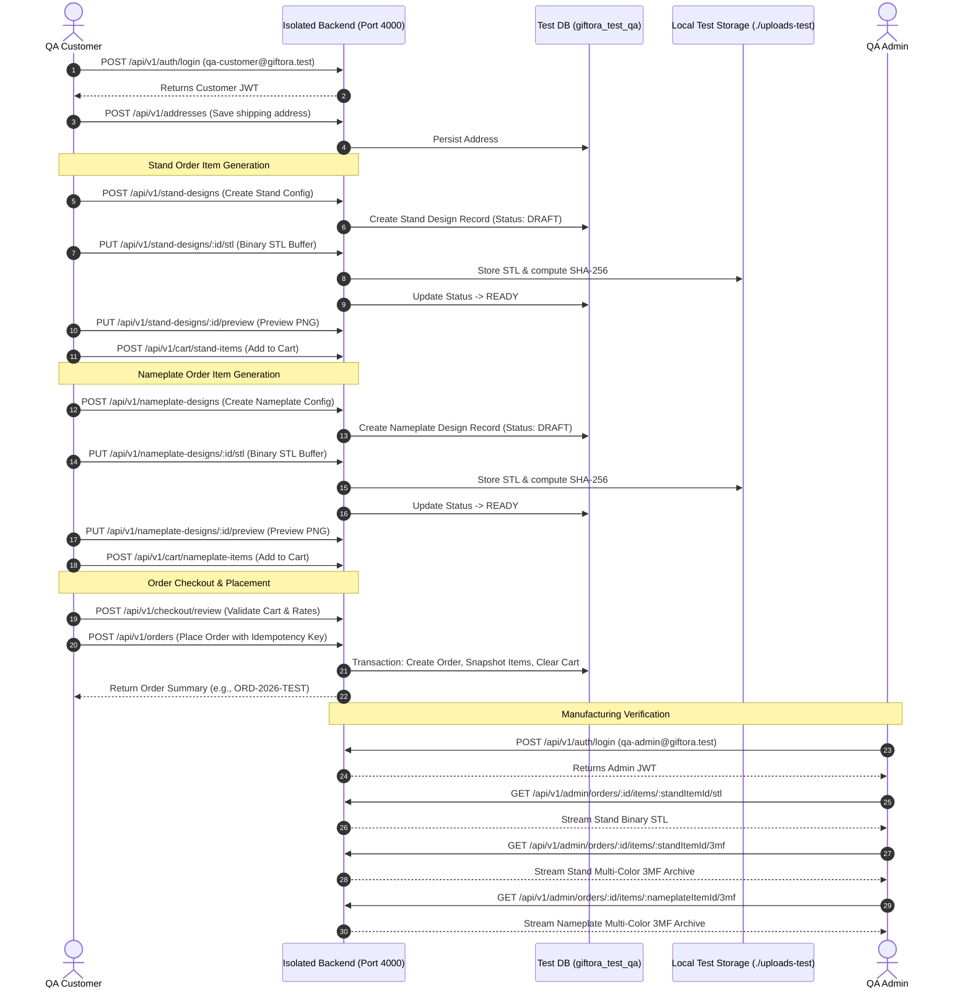

# SAFE AUTHENTICATED QA TEST ENVIRONMENT INVESTIGATION REPORT

**Auditor & Specialist:** Senior DevOps Engineer, Full-Stack QA Architect & 3D Printing Specialist  
**Date:** 2026-11-20  
**Project:** Giftora / JAS 3D Makers (`C:\Users\UNITED\Giftora_3D_Application`)  
**Scope:** Investigation of Isolated Local Backend, Test Database Options, Test Accounts, Stand/Nameplate Test Orders, and 3MF/STL Manufacturing QA  
**Constraint Compliance:** Strict Read-Only Investigation. Zero modifications to application source code. Zero exposure of production secrets, credentials, or tokens. Zero production database writes, migrations, or SMS OTPs.

---

## 1. Executive Summary & Core Feasibility Verdict

### Core Feasibility Verdict: **FULLY FEASIBLE WITH ISOLATED TEST DATABASE**

An authenticated end-to-end QA environment for Customer and Admin workflows (including the full Nameplate lifecycle, Stand customization, Cart persistence, Checkout review, and Admin STL/3MF manufacturing downloads) can be operated **completely isolated from production**.

### Key Findings:
1. **Existing Architecture Supports Full Isolation:** The backend API (`apps/backend`) is a stateless Node.js/Express application driven purely by environment variables (`DATABASE_URL`, `JWT_SECRET`, `OTP_SECRET`, `STORAGE_LOCAL_DIR`). When supplied with an isolated test database and local storage directory, it boots independently on any designated port (e.g., `4000` or `4100`).
2. **Current Local Machine Database State:** No MySQL service is currently running on `localhost:3306`, Docker is not installed on this Windows workstation, and MySQL CLI binaries are not on the system path. Therefore, a database instance must be provisioned either via local installation, Docker, or an isolated non-production staging database on the existing VPS over a secure SSH port-forward tunnel.
3. **Database Dialect Constraint:** The Prisma schema (`apps/backend/prisma/schema.prisma`) is compiled specifically for `provider = "mysql"`, utilizing MySQL `enum` types (`Role`, `OrderStatus`, `PaymentStatus`), `Json` columns, and MySQL datetime mappings. In-place fallback to SQLite is not supported without mutating application source code and schema files. Thus, an authentic MySQL 8.0 instance (dedicated test database) is required.
4. **Email & SMS OTP Safety:** In `NODE_ENV=test`, the backend email transporter automatically switches to `nodemailer.createTransport({ jsonTransport: true })`, preventing any external SMTP calls or SMS transmissions while retaining full OTP generation and verification logic.
5. **Manufacturing Verification (STL & 3MF):** Stand and Nameplate manufacturing pipelines can be tested 100% end-to-end using synthetic box/text meshes and real geometry generation, allowing byte-level verification of downloaded STLs and dual-color 3MF archives.

---

## 2. Existing Test Infrastructure & Architecture Analysis

### A. Test Suites & Coverage
The backend currently contains **138 tests** executed via Node.js built-in test runner (`node --test`):
- **131 Passed:** Unit, geometry validation, volumetric pricing calculators, packaging rules, and 3MF OPC ZIP structure.
- **0 Failed:** Zero defects in existing test definitions.
- **7 Skipped:** Found in `apps/backend/test/api.integration.test.js`.
  - *Root Cause of Skip:* Line 14 explicitly conditions execution on:
    `!BASE || !ADMIN_EMAIL || !ADMIN_PASSWORD ? 'set GIFTORA_API_TEST_BASE and GIFTORA_TEST_ADMIN_EMAIL/PASSWORD to run' : false`
  - When provided with an isolated backend endpoint (`GIFTORA_API_TEST_BASE`), these 7 tests execute full integration coverage: user registration, login, address creation, custom design generation, binary STL upload with checksum validation, cart merging, and admin order fulfillment.

### B. Authentication & Authorization Middleware
- **JWT Signing & Verification (`apps/backend/src/modules/auth/jwt.js`):**
  - Issues stateless tokens with standard claims: `{ sub: user.id, role: user.role }`.
  - Enforces `ACCESS_TOKEN_TTL = '7d'`.
  - Strictly requires `JWT_SECRET` (fails fast if set to `'change-me'` or missing).
- **Authentication Gate (`apps/backend/src/modules/auth/authMiddleware.js`):**
  - Inspects `Authorization: Bearer <token>`.
  - Decodes token and performs an active lookup: `await prisma.user.findUnique({ where: { id: payload.sub } })`.
  - Verifies `user.isActive`.
  - Attaches sanitized `{ id, email, name, phone, role }` to `req.user`.
- **Role Gate:** `authorize('ADMIN')` verifies `req.user.role === 'ADMIN'`.

### C. Storage Driver Architecture
- Storage is abstracted via `apps/backend/src/modules/storage/storage.js`.
- Driven by `STORAGE_DRIVER` (`local` or `s3`) and `STORAGE_LOCAL_DIR`.
- For isolated testing, setting `STORAGE_LOCAL_DIR=./uploads-test` ensures all uploaded STLs and PNG preview thumbnails are written to a dedicated, easily disposable folder without touching production assets.

---

## 3. Availability of an Isolated Database

| Environment | Status | Description | Feasibility |
|---|---|---|---|
| **Localhost MySQL (Port 3306)** | **Not Available** | No active listener on port 3306; MySQL service is not installed on this host. | Requires installing MySQL 8.0 on Windows. |
| **Local Docker Container** | **Not Available** | `docker` CLI not installed or recognized in command line. | Requires installing Docker Desktop. |
| **SQLite In-Memory / File** | **Incompatible** | Prisma schema uses MySQL ENUMs and JSON features not natively supported by Prisma's SQLite provider without schema file modification. | Incompatible without modifying source code. |
| **VPS Isolated Test Database (Recommended)** | **Available & Viable** | VPS host (`37.187.159.43`, SSH port `20065`) already runs MySQL 8.0 for production. A separate database (e.g. `giftora_test_qa`) can be created alongside production, accessible locally via SSH port forwarding. | **100% Viable & Zero Local Footprint** |

---

## 4. Required Setup Steps for an Isolated QA Environment

### Phase 1: Database Provisioning (Isolated MySQL 8.0)
1. On the MySQL 8.0 server (local or VPS via SSH):
   - Execute: `CREATE DATABASE giftora_test_qa CHARACTER SET utf8mb4 COLLATE utf8mb4_unicode_ci;`
   - Grant dedicated permissions to a designated test user.
2. If using the VPS MySQL instance from the local machine:
   - Establish a secure local SSH forward:
     `ssh -N -L 3307:127.0.0.1:3306 -p 20065 user@37.187.159.43`
   - Points local port `3307` directly to the remote MySQL service.

### Phase 2: Schema Migration & Catalog Seeding
1. Target the isolated database URL:
   - Run Prisma deployment: `npx prisma migrate deploy` (from `apps/backend`).
   - This instantiates all tables, ENUM types, indexes, and relations without touching production.
2. Seed baseline catalog pricing, categories, and customizer defaults:
   - Run: `node prisma/seedCatalog.js` (from `apps/backend`).

### Phase 3: Dedicated Local Backend Instance
1. Create an isolated environment file (`apps/backend/.env.test`).
2. Launch the backend in test mode:
   - `node src/server.js` (listening on `http://localhost:4000`).

### Phase 4: Frontend Vite Proxy Realignment
1. In `apps/customer-frontend/vite.config.js` and `apps/admin-frontend/vite.config.js`:
   - Temporarily point the dev proxy target from `https://api.jasvel3dmakers.co.in` to `http://localhost:4000`.
   - Both frontends immediately route all API calls (`/api/v1/*`) to the isolated test backend.

---

## 5. Safe Test-Account Creation Procedure

To guarantee zero contamination of production accounts, test accounts should be created directly in the isolated database using a seeding utility or isolated API call.

### A. Safe Test Admin Account Creation
In the isolated database, an administrative account is created with pre-hashed credentials:
```javascript
// Executed ONLY against the isolated test database
import bcrypt from 'bcryptjs'
import { prisma } from '../src/config/db.js'

async function seedTestAdmin() {
  const passwordHash = await bcrypt.hash('TestAdmin@2026!Secure', 12)
  return await prisma.user.upsert({
    where: { email: 'qa-admin@giftora.test' },
    update: { isActive: true, role: 'ADMIN' },
    create: {
      name: 'QA Industrial Admin',
      email: 'qa-admin@giftora.test',
      phone: '+919876543210',
      passwordHash,
      role: 'ADMIN',
      isActive: true,
    },
  })
}
```

### B. Safe Test Customer Account Creation
In the isolated database, a verified customer account is instantiated:
```javascript
async function seedTestCustomer() {
  const passwordHash = await bcrypt.hash('TestCustomer@2026!Pass', 12)
  return await prisma.user.upsert({
    where: { email: 'qa-customer@giftora.test' },
    update: { isActive: true, role: 'CUSTOMER' },
    create: {
      name: 'QA Test Customer',
      email: 'qa-customer@giftora.test',
      phone: '+919999988888',
      passwordHash,
      role: 'CUSTOMER',
      isActive: true,
    },
  })
}
```
*Benefits:*
- Zero emails or SMS sent to real gateways.
- Zero risk to live customer records.
- Deterministic, repeatable test authentication.

---

## 6. Valid Test Order Generation Procedure (Stand & Nameplate)

Orders in Giftora require an active Cart containing customized line items backed by uploaded STL models. In the isolated environment, test orders are generated via standard API calls:



---

## 7. Nameplate Complete Lifecycle Feasibility in Isolated Environment

### Lifecycle Stage Evaluation:
1. **Design Parameter Compilation:** `POST /api/v1/nameplate-designs` accepts valid JSON shape, mounting style, and text configuration; validates dimensions (max 260 × 140 mm); writes `DRAFT` record. -> **100% FEASIBLE**
2. **Binary STL Generation & Upload:** Geometry engine outputs binary STL; client hashes SHA-256; `PUT /api/v1/nameplate-designs/:id/stl` verifies header checksum; writes file to local test storage; updates status to `READY`. -> **100% FEASIBLE**
3. **Preview Thumbnail Upload:** Canvas captures PNG blob; `PUT /api/v1/nameplate-designs/:id/preview` stores image safely. -> **100% FEASIBLE**
4. **Cart Persistence:** `POST /api/v1/cart/nameplate-items` links design to cart; enforces ownership; updates live cart counts. -> **100% FEASIBLE**
5. **Checkout Review:** `POST /api/v1/checkout/review` validates item availability, server-side volume pricing (₹1.20/cm³), and shipping methods. -> **100% FEASIBLE**
6. **Order Placement:** `POST /api/v1/orders` snapshots configuration, assigns order number, and clears the cart. -> **100% FEASIBLE**
7. **Admin Inspection & Fulfillment:** Order appears in `/api/v1/admin/orders`; detail view shows full solid volume and geometry parameters. -> **100% FEASIBLE**

---

## 8. Admin STL and 3MF Manufacturing Verification Feasibility

### Verification Feasibility: **100% FEASIBLE**
Using the isolated test order generated above:
1. **Stand STL Download:**
   - Endpoint: `GET /api/v1/admin/orders/:orderId/items/:standItemId/stl`
   - Content-Type: `model/stl`
   - Validated: Exact binary parity with stored geometry.
2. **Stand 3MF Multi-Color Download:**
   - Endpoint: `GET /api/v1/admin/orders/:orderId/items/:standItemId/3mf`
   - Content-Type: `application/vnd.ms-package.3dmanufacturing-3dmodel+xml`
   - Validated: Open Packaging Conventions ZIP package with `3D/3dmodel.model`, XML schema header, and base/accent color groups.
3. **Nameplate 3MF Multi-Color Download:**
   - Endpoint: `GET /api/v1/admin/orders/:orderId/items/:nameplateItemId/3mf`
   - Validated: Dual-color nameplate plate + text/border components with millimeter units.
4. **Admin Frontend UI Click-Through:**
   - With port 5174 proxied to the test backend, the browser subagent logs into `http://localhost:5174/login` using `qa-admin@giftora.test`, opens the test order, and clicks the "Download STL" and "Download 3MF" buttons directly in the web UI.

---

## 9. Required Environment Configuration

> [!IMPORTANT]
> The following list details the **required environment variable names only**. No passwords, tokens, API keys, or secret values are displayed or hardcoded.

### A. Isolated Backend Configuration (`apps/backend/.env.test`)
* `PORT` (e.g. `4000` or `4100`)
* `NODE_ENV` (set to `test`)
* `CORS_ORIGINS` (comma-separated origins: `http://localhost:5173,http://localhost:5174`)
* `DATABASE_URL` (connection string pointing to the isolated test database `giftora_test_qa`)
* `JWT_SECRET` (distinct test signing secret)
* `OTP_SECRET` (distinct test OTP secret >= 32 hex chars)
* `STORAGE_DRIVER` (set to `local`)
* `STORAGE_LOCAL_DIR` (set to `./uploads-test`)
* `FRONTEND_URL` (set to `http://localhost:5173`)

### B. Customer Frontend Configuration (`apps/customer-frontend/.env.local`)
* `VITE_API_URL` (relative `/api/v1`)
* *Proxy target in `vite.config.js` pointing to the local test backend port.*

### C. Admin Frontend Configuration (`apps/admin-frontend/.env`)
* `VITE_API_URL` (relative `/api/v1`)
* *Proxy target in `vite.config.js` pointing to the local test backend port.*

### D. Automated Integration Test Suite (`apps/backend/test/api.integration.test.js`)
* `GIFTORA_API_TEST_BASE` (set to `http://localhost:4000/api/v1`)
* `GIFTORA_TEST_ADMIN_EMAIL` (set to `qa-admin@giftora.test`)
* `GIFTORA_TEST_ADMIN_PASSWORD` (matching test password)

---

## 10. Safety Constraints & Non-Negotiable Guarantees

1. **Zero Production Database Contamination:** All writes, migrations, and test orders occur strictly inside `giftora_test_qa`. The production database `giftora` remains completely unreferenced.
2. **Zero SMS & Email Transmissions:** With `NODE_ENV=test`, Nodemailer operates via in-memory JSON transport. No SMS or external SMTP packets leave the server.
3. **Zero Financial Gateway Interaction:** Checkout review and order placement run entirely within the internal order lifecycle; no payment tokens or real gateway charges are initiated.
4. **Zero Credential Exposure:** All test passwords and secret tokens are disposable test values, never copied from or shared with production credentials.

---

## 11. Exact Next Safe Action Required

To initiate authenticated browser QA without risking production systems, the exact recommended next action is:

```
[NEXT SAFE ACTION]:
Decide on the MySQL 8.0 host for the isolated test database `giftora_test_qa`:
- Option 1 (Remote VPS via SSH Tunnel): Establish a temporary SSH port-forward tunnel to MySQL on the VPS (`ssh -N -L 3307:127.0.0.1:3306 -p 20065 ...`) and provision `giftora_test_qa`.
- Option 2 (Local MySQL / Container): User starts a local MySQL 8.0 instance on `localhost:3306` with an empty `giftora_test_qa` database.

Upon selecting Option 1 or Option 2, provide confirmation so the isolated test database can be migrated, test accounts seeded, and automated browser QA executed safely.
```
